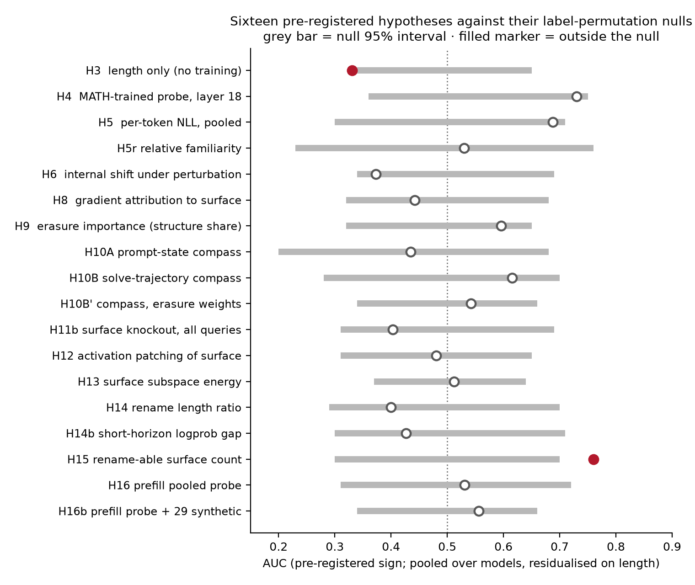

# Sixteen pre-registered probes and one partial signal: a negative-results report on predicting mathematical robustness

*AIMO Interpretability Challenge (NeurIPS 2026) — technical report draft. Target: 4–6 pages, workshop format.
Draft status: all sections drafted with measured numbers. Every number below is taken from a committed run
log in `experiments/results/`; nothing is estimated or recalled.*

---

## Abstract

We ask whether a model's internal state or a problem's surface text predicts **robustness** — whether a model that
solves a problem keeps solving answer-preserving rewrites of it. We ran **sixteen pre-registered hypotheses** against
the organisers' 33 labelled problems, fixing each metric's sign and its decision rule before looking at results, and
judging every score against a problem-level permutation null. **Fifteen produced nothing distinguishable from chance.**
The exception is a text-only count: the number of characters a symbol-renaming perturbation would change separates
robust from spurious problems at AUC 0.760 against a null of [0.30, 0.70]. Residualising on problem length pulls it back
to 0.673, inside the band, so the signal is entangled with length; an external check on our own synthetic labels
dissociates the two (symbol count keeps its direction at 0.708 while length reverses to 0.221). Submitted as a rule, it
scored 0.50 on the 14-problem leaderboard — indistinguishable from the constant baseline. We report three things we
believe are more useful than a method: a power analysis showing **33 problems cannot resolve AUC below ~0.75**, two
label-generation pitfalls that silently manufacture or destroy labels, and the measurement bugs that produced our own
early false positives.

## 1 Introduction

- Task: given `model_id` and a problem statement, predict whether that model's success survives answer-preserving
  perturbation. Inputs are only those two fields.
- Why it is hard here, stated up front: the labels released for training are **problem-level**, the evaluation budget
  forbids test-time generation at scale, and the sample size cannot resolve the effect sizes anyone is likely to find.
- Contributions: (i) a pre-registered sweep of sixteen hypotheses with nulls, (ii) a power analysis that bounds what the
  public data can decide, (iii) documented pitfalls in self-generated labels, (iv) one partial text-only signal and its
  failure to transfer.

## 2 Setup and three structural constraints

**2.1 Labels are problem-level.** In `train-main-v2`, of the 11 problems that appear for two or more models, **11/11
carry the same label across models** (0/11 split), and monotonicity across model ability is violated in **0/37 pairs**.
Per-model robustness rates are flat: Olmo 0.78, gpt-oss 0.76, DeepSeek 0.70, Qwen3.5 0.67, Skywork 0.67. Consequence:
any feature built from a model×problem *interaction* has almost no variance to explain. We verified this prediction
directly — relative-familiarity features (a model's NLL minus the mean of the other three) score 0.490–0.551 on 31
model-problem rows, i.e. chance (`h5_relative_report.txt`).

**2.2 The time budget forbids test-time generation.** Official FAQ 8: "Each submission has 3600 seconds for the entire
prediction run, covering all models and all problems together." We measured the cost of the generation-based family:
one original solution averages **11,483 generated tokens** (`h14_report.txt`). Three generations per problem over ~240
instances is 5.3–11.8M tokens, i.e. 5,300–11,800 s at an optimistic 1,000 tok/s. The whole family is therefore
inadmissible regardless of whether it works.

**2.3 Thirty-three problems cannot resolve the effect sizes in question.** Permutation nulls on 33 problems
(20 robust / 13 spurious) put the 97.5th percentile at 0.703. A binormal power simulation (3000 draws per cell,
`analysis/power_33.py`) gives the probability that a method with a given true AUC is detected:

| True AUC | 0.60 | 0.65 | 0.70 | 0.75 | 0.80 | 0.90 |
|---|---|---|---|---|---|---|
| Detection, official 33 problems (20/13) | 0.16 | 0.30 | **0.51** | 0.70 | 0.88 | 1.00 |
| Detection, our 29 synthetic labels (24/5) | 0.10 | 0.16 | 0.29 | 0.43 | 0.59 | 0.92 |
| Detection, 200 problems (120/80) | 0.84 | 0.99 | 1.00 | 1.00 | 1.00 | 1.00 |

A true AUC of 0.70 is a coin flip to detect, and the observed AUC of a genuinely 0.70 method has standard deviation
0.091 on this sample size. Two consequences shaped the rest of the work: a null result here does not mean a method is
worthless, and a single "outside the null" hit is not evidence until it survives an independent test.

A second row of that table matters for our own process. Estimating the null from **30** permutations instead of 1000
puts its upper edge at 0.680 rather than 0.703 and raises apparent detection at true AUC 0.70 from 0.51 to 0.60 —
cheap permutation budgets manufacture significance. We re-ran our pooled tests at 1000 after finding this.

## 3 Methodology

- **Pre-registration.** Every hypothesis was written into the project log with its metric, its **fixed sign**, its
  control variables and its checkpoint *before* the corresponding run. When a result came out in the opposite
  direction we recorded it as such and did **not** flip the sign (H6 and H14 are the two cases).
- **Null distribution.** Problem-level label permutation. Early runs used 30 permutations; we moved to **1000** after
  discovering that 30 permutations under-estimate the band width and manufacture spurious "outside the null" flags —
  one pooled score moved from ▲ at [0.36, 0.62] to inside at [0.31, 0.69] purely from the null estimate.
- **Length control.** Every score is reported raw and residualised on problem length (and, where generation is
  involved, on generated length and the unfinished-sample rate). Length has been the dominant confound in this task
  since our first probe: an early hidden-state probe reached CV balanced accuracy 0.634 on an older label set, but word
  count alone gave AUC 0.75 and the probe's correlation with length was ρ = +0.71.
- **Multiple comparisons.** Each hypothesis declares one primary metric; everything else is labelled exploratory and is
  not claimed.

## 4 Results

*Figure 1. Each row is one hypothesis' pre-registered primary metric: the marker is the observed AUC, the
grey bar its label-permutation null 95% interval. Filled markers fall outside the null — two of eighteen,
one of them (H3) in the direction opposite to the hypothesis. Generated by `report/make_fig_auc.py`; every
value is read from a committed report in `experiments/results/`. The figure covers H1-H16, the
hypotheses registered before 2026-10-02; the table below continues with H17-H23, whose reports were added later.*

All AUCs are oriented so that higher means "better separates robust from spurious" under the pre-registered sign.
"Pooled" means per-model scores averaged per problem, then residualised. n = 33 official problems unless noted.

| # | Hypothesis | Primary metric | AUC | Null 95% | Verdict |
|---|---|---|---|---|---|
| H1 | Batch median split rescues a weak probe | 12-feature LOPO | 0.71 (sign-flipped only) | — | no |
| H2 | Robustness tracks difficulty times model ability | label consistency | 11/11 agree, 0/37 violations | — | labels problem-level |
| H3 | Pooling problems across models helps | length, untrained | 0.331 ▼ | [0.34, 0.65] | reversed |
| H4 | Probe trained on old MATH labels transfers | DeepSeek layer 18 | 0.730 | [0.36, 0.75] | no |
| H5 | Memorised problems are robust | per-token NLL, pooled | 0.688 | [0.30, 0.71] | length proxy |
| H5r | Relative familiarity across the four models | rel_nll | 0.530 | [0.23, 0.76] | no |
| H6 | Robust problems shift less under perturbation | d_last_all, pooled | 0.373 | [0.34, 0.69] | reversed |
| H7 | — (not registered: H6 missed its checkpoint) | — | — | — | — |
| H8 | Gradients concentrate on surface tokens | attribution ratio | 0.442 | [0.32, 0.68] | no |
| H9 | Erasure importance separates structure from surface | structure share | 0.596 | [0.32, 0.65] | no |
| H10A | Prompt state points toward the answer | compass | 0.435 | [0.20, 0.68] | no |
| H10B | Solve trajectory turns toward structure | compass_mean | 0.615 | [0.28, 0.70] | models disagree |
| H10B' | Same compass, weighted by erasure importance | compass | 0.542 | [0.34, 0.66] | no |
| H11 | A layer frees the state from surface tokens | lib_cos | 0.787 | — | invalid measurement |
| H11b | Same, blocking every query not just the last | lib_kl | 0.403 | [0.31, 0.69] | no |
| H12 | Transplanting surface activations changes the answer | patch effect | 0.480 | [0.31, 0.65] | no |
| H13 | Surface occupies a measurable subspace | subspace energy | 0.512 | [0.37, 0.64] | no |
| H14 | Renaming symbols makes generation longer | length ratio | 0.400 | [0.29, 0.70] | reversed |
| H14b | Renaming raises uncertainty in the first 1024 tokens | logprob gap | 0.427 | [0.30, 0.71] | no |
| H15 | More rename-able surface means less robust | symbol count | **0.760 ▲** | [0.30, 0.70] | partial (§6) |
| H16 | Prefill states predict robustness, pooled over models | nested LOO | 0.531 | [0.31, 0.72] | no |
| H16b | The same probe, plus 29 self-generated labels | nested LOO | 0.556 | [0.34, 0.66] | no |
| H17 | Reproduce the labelling procedure at test time | mean accuracy drop | not measured | — | kernel died (`KeyError`) |
| H18 | Memorised statements score high on Min-K%++ | Min-K%++ 20 | 0.454 | [0.30, 0.72] | no |
| H18b | Half a statement is enough to complete it | ROUGE-L | 0.490 | [0.30, 0.70] | no |
| H19 | Renaming makes a memorised statement unfamiliar | NLL gap | 0.368 | [0.29, 0.71] | reversed |
| H20a | Problems the model solves at length are spurious | mean generated tokens | **0.850 ▲** | [0.30, 0.72] | budget-bound (§4.1) |
| H21a | Short-horizon generation is more uncertain | mean token entropy | 0.608-0.658 | null upper 0.71-0.72 | no (4/4 models) |
| H21b | The model is less sure of its own snap answer | forced-answer logprob | 0.304-0.650 | all inside | models disagree in sign |
| H21c | A changed constant should drop the old answer | logp drop, 1 variant | **0.802 / 0.741 ▲** | [0.28, 0.71] | did not replicate (§4.2) |
| H21cK | The same, averaged over K deterministic variants | mean drop, K=4 | 0.604 (model mean) | — | 1 of 4 models outside null |
| H21p | Sensitive to relevant edits, insensitive to irrelevant ones | drop - d_irrel | 0.789 (DeepSeek) | [0.28, 0.71] | combination worse than drop alone |
| H22 | Reproduce the organisers' label definition faithfully | P(stable) x majority-wrong | 0.673 | [0.31, 0.70] | no (§4.3) |
| H23 | Membership inference, scored against model-specific labels | Min-K% 20 | 0.408 | [0.37, 0.63] | length proxy (§5.6) |

Three later entries need a paragraph each; they are the ones whose failure mode is structural rather
than statistical, and §4.1-4.3 give them. First, two earlier entries deserve a note rather than a row. **H11** formally produced the largest pooled AUC we ever saw (0.787),
and we discarded it: blocking every surface token at every layer changed the final-token state by a cosine of
0.000–0.005, so the "liberation layer" was a threshold on numerical noise; the control-subtracted version (0.644) sat
inside the null and the four models' rankings disagreed (ρ −0.41 to +0.46). **H10B** is the clearest instance of
model disagreement: Skywork 0.692 and Qwen 0.638 against DeepSeek **0.296**, i.e. the same metric points in opposite
directions on different models, which is what a problem-level label predicts.

### 4.1 H20: the strongest number we measured, and why it is unusable

Mean generated tokens on the original problem reaches AUC **0.850** (length-residualised 0.792): robust problems
average 9,274 tokens, spurious ones 14,366. It is also the only metric here that an inference budget can price out of
existence. Re-scoring the same stored generations under different caps gives 4,096 → 0.441, 8,192 → 0.369,
12,288 → 0.379, 16,384 → 0.690, because the fraction of samples that hit the cap falls from 0.88 to 0.00. **The signal
is a function of the budget, not of the problem.** Under the 3,600-second batch total, a 35-problem call buys cap
6,144 at most, where the threshold equals the cap and the score carries no information.

Measured per model (cap 12,288, k=1), the same metric gives Olmo **0.850**, Skywork **0.762**, DeepSeek **0.575** —
and the gap is saturation, not model character: DeepSeek hits the cap on 90.9% of generations and takes only 4 distinct
values across 33 problems. The leaderboard confirmed it. Our per-model submission (h20e) generated with each judged
model in turn and split at the within-call median; the worker log shows Qwen3.5 and DeepSeek **saturating at the cap
with zero spread**, so two of four models fell back to a text rule. Score 0.43 against 0.57 for the fixed-instrument
version — a two-problem difference, i.e. noise, but the saturation is structure.

### 4.2 H21c: a single perturbation is a single die roll

Forcing `</think>
ANSWER:` and scoring the model's own 8-token snap answer under one constant-changed variant gave
AUC **0.802** (DeepSeek) and **0.741** (Skywork), the only pre-registered primary metrics that ever cleared their
nulls in the intended direction. Two follow-ups dissolved it. (i) Averaging over K deterministic variants
(K = 1, 2, 4, 8, 16) stabilises the estimate at a *lower* value: the four-model mean peaks at 0.604 (K=4) and only
DeepSeek stays outside its null; the specific variant that produced 0.802 ("increment the last number") is worth
+0.09 over the K=1 grid variant. (ii) The confirmation test on 88 independently generated labels for the same model
gave **0.594** inside a [0.34, 0.65] null, while the same script reproduces 0.660 on the official 33 — so the
pipeline is intact and the signal is not. We also found the rule itself does not apply to a quarter of our problem
pool: 22 of 88 statements contain no number the deterministic rule will touch (large numbers, fractions, pure
symbols), against 1 of 33 officially.

### 4.3 H22: reproducing the definition does not reproduce the labels

The organisers' paper defines a label by majority vote over answer-preserving perturbations, not by a drop threshold,
and uses six perturbation types. Our surviving signal (H21c) used one answer-*changing* type, so the natural
explanation for its failure was that we had never implemented the definition. We implemented it: N=4 original samples
for a pseudo-ground-truth majority answer, K=6 answer-preserving perturbations (two renames, two typo variants, two
distractors, plus a model-written rephrase that passes a number-multiset check), S=2 samples each, cap 24,576, scored
as P(stable) x (fraction of perturbations whose majority answer differs). **AUC 0.673 against a [0.31, 0.70] null**;
accuracy at the natural 0.5 threshold 0.645 against a 0.613 constant baseline, one problem apart.

The informative comparison is internal. A crude earlier version computed from stored data — K=2, renames only —
scored **0.675**. Going from two perturbation types to six, including a model-written rephrase, moved the AUC by
**0.002**. Perturbation diversity was not the missing piece. Two limits belong with the number: with no ground truth
we substitute self-consistency for correctness, which cannot see a problem the model gets consistently wrong; and
11% of samples still hit the 24,576 cap and were excluded rather than counted wrong.

## 5 Pitfalls in self-generated labels

With 33 labels we tried to make more, using answer-preserving perturbations of public problems. Two pitfalls each cost
us a full run, and we believe both are general.

**5.1 Conditioning on completion selects for correctness.** Excluding generations that hit the token cap seems like the
careful choice — an unfinished run is missing data, not a wrong answer. On hard problems it is not: the model finishes
*when it has found the answer* and runs to the cap when it is lost. Measuring accuracy over finished samples only,
**42 of 43** screened problems came out at accuracy 1.0 and a 0.25–0.75 band accepted **one** problem. Counting
unfinished samples as wrong spread the same screening data to 0.0 ×17, 0.25 ×5, 0.5 ×3, 0.75 ×9, 1.0 ×26.

**5.2 A token cap manufactures spurious labels.** With accuracy counting unfinished as wrong, 14 problems came out
spurious — and **13 of the 14** were spurious because the *perturbed* problem ran past the cap, not because the answer
changed. Re-running those 13 with the cap raised from 8,192 to 16,384 tokens, original and perturbed alike, recovered
**9 as artifacts** and left **4 real**. The original problems' own accuracy also moved in 5 of 13 cases (mean 0.88 →
0.98), so the 8,192 cap was mis-measuring difficulty itself. All four surviving cases were symbol-renaming; every
typo and distractor failure disappeared when given more budget.

**5.3 A circular metric.** Before 5.2 we noticed that "increase in unfinished rate after perturbation" separated our
labels at AUC 1.000. That is not a finding: with 13/14 spurious labels created by unfinished generations, the metric
re-reads the labelling rule. We report it as a worked example of how a self-generated label set can hand back its own
definition as a signal.

**5.4 Label-definition sensitivity: how unfinished runs are counted reverses the conclusion.** Sections 5.1–5.2 fixed
the cap; they did not remove the dependence on the counting rule. We therefore stored *two* labels for every generated
problem from the same runs — `label`, which counts an unfinished sample as wrong, and `label_fin`, which uses only
finished samples as the denominator — and evaluated every downstream method against both. On the 88 problems we
generated for Skywork-OR1-Math-7B (MATH level 5 and AIME, cap 16,384) the two definitions agree on **72 of 88 (82%)**,
and the 18% of problems where they disagree decide the outcome:

| quantity | `label` (unfinished = wrong) | `label_fin` (finished only) |
|---|---|---|
| robust / spurious | 62 / 26 | 76 / 12 |
| hidden-state probe, 5-fold AUC | 0.367 | 0.658 |
| shuffle null 95% (200 perms) | [0.32, 0.63] | [0.34, 0.68] |
| length control, log word count | **0.624** | 0.516 |
| H21c constant-edit drop, AUC (n=66) | 0.594 | 0.417 |

Under `label` the length control *beats* the probe (0.624 against 0.367), and under `label_fin` length collapses to
0.516 while the probe rises to 0.658. The constant-edit metric of Section 6 changes sign between the two columns.
Neither probe column clears its own null, so we claim no signal in either; what we do claim is that **a self-generated
label set carries a free parameter that can invert a method's apparent direction**, and that reporting one definition
without the other is not enough. The earlier, smaller version of this comparison was more extreme: at cap 8,192 the two
definitions agreed on only **56%** (robust 8 / spurious 8 against robust 15 / spurious 1), with **7 of 8** spurious
labels flipping. Raising the cap to 16,384 moved agreement to **90%** on those 24 problems, which is why we adopted it —
but at 88 problems agreement settled back to 82%, because the larger sample drew in longer problems.

**5.5 Cap saturation is the mechanism, and it does not stay in the lab.** Both pitfalls above and the sensitivity in 5.4
have one cause: a token cap turns "how long this model thinks" into a component of every accuracy-derived label and of
every generation-length feature. Three independent measurements show the same thing.

| measurement | cap-hit rate | distinct values | AUC |
|---|---|---|---|
| Original-generation length, DeepSeek-R1-Qwen3-8B (33 problems, cap 12,288) | 90.9% | 4 of 33 | 0.575 |
| same, Olmo-3-7B-Think | 57.6% | 15 of 33 | 0.850 |
| same, Skywork-OR1-Math-7B | 39.4% | 21 of 33 | 0.762 |

The ordering is monotone in saturation, not in model quality: the model whose generations almost always hit the cap has
four distinct feature values across 33 problems and an AUC at chance. Re-capping the *same* stored generations shows the
other half of the effect — the perturbation-drop metric reads 0.441, 0.438, 0.369, 0.379 and 0.690 at caps of 4,096,
6,144, 8,192, 12,288 and 16,384, as the fraction of over-cap samples falls from 0.88 to 0.00. **The signal is a function
of the inference budget, not only of the problem.**

This reaches the leaderboard. Our length-based entry, which judged each model by its own generation lengths, scored
**0.43 (6/14)**; the worker log shows why. For two of the four models every generation hit the cap — Qwen3.5-4B at 12,288
and DeepSeek at 16,384, with zero spread — so those calls fell through to the text fallback, while only Skywork produced
a usable spread (2,481–16,384 tokens). The run used 2,927 s of the 3,600 s budget to measure nothing on half the models.
Raising caps is not a way out: with a 3,600 s total budget, 35 problems per model, and our fitted per-step timing model,
the largest affordable cap is 6,144, and at 4,096–6,144 the stored grid gives thresholds equal to the cap itself, a
predicted-True rate of 1.00, and AUCs of 0.600–0.662. **The budget cannot buy the regime where the signal exists.**

**5.6 Independent reproduction of our one partial signal failed, and its applicability is narrow.** Section 6 reports a
constant-edit metric that cleared its null on the official 33-problem set. Two follow-ups weakened it. First, the
single-edit version is unstable in the choice of edit: with the edit our submission used it scored 0.741 for Skywork,
and with a different deterministic edit from the same family 0.685; averaging K deterministic edits stabilises the
estimate at a *lower* value (0.658 at K=4, 0.650 at K=16). We therefore pre-registered the K=4 average, not the lucky
single draw. Second, we ran that pre-registered setting against the 88 independent self-generated labels:

| set | n | AUC | shuffle null 95% | bootstrap 95% CI | length-residual AUC |
|---|---|---|---|---|---|
| official problem-level labels | 32 | 0.660 | — | — | — |
| self-generated, `label` (primary) | 66 | **0.594** | [0.34, 0.65] | [0.44, 0.73] | 0.585 |
| self-generated, `label_fin` (control) | 66 | 0.417 | [0.29, 0.72] | [0.23, 0.60] | 0.423 |

The primary estimate sits inside its null and its bootstrap interval contains 0.5; the control label reverses the sign.
The same script reproduces 0.660 on the official set, so this is a failure to reproduce across label sets, not a code
difference. A third limitation is purely practical and we had not anticipated it: the edit rule changes one integer in
the 2–9 or 2–4-digit range, and on **22 of the 88** problems (25%) no such edit exists — the problems are built from
large numbers, fractions or symbols alone. On the official 33-problem set the same rule failed on **1 (3%)**. A method
whose applicability drops eightfold with the problem distribution hands a quarter of the final set to its fallback tier.

**5.5 Knowing the label definition is not enough: the perturbation suite has to be able to fire it.** Once we knew the
organisers use a majority rule, we recomputed it on our own labels. It produces almost no positives. Across our
three k=8 label sets (Skywork, Olmo, DeepSeek; 102 problems) the number of perturbation types broken per problem is
0 for 77 problems, 1 for 20, and **2 or more for 5** — so a majority of three types is reached in **4.9%** of
problems, while the organisers obtain 19 spurious of 71 (**27%**) with the same rule. The binding quantity is not the
number of types but the per-type break rate: ours is **10.9%**, measured over 276 type-instances at k=8. Under a
binomial model a majority then fires with probability 3.3% at three types, 0.5% at four and **0.2% at six** — adding
types *raises* the threshold faster than it adds chances. Reaching 27% needs a per-type rate of 40–50%, four times
ours. (Within-problem correlation would help, and we looked: only Olmo shows it, 3 observed majorities against 1.3
predicted under independence. Skywork gives 0 against 0.1 and DeepSeek 2 against 2.0, so fragile-across-types
problems are not a general feature of our sets.)

We then tried to buy the missing strength with the one type we lacked, Domain (rewriting the story around unchanged
mathematics), using a larger instruct model as the rewriter and a two-stage answer-preservation check (number
multiset, then a bidirectional self-judgement, both required). Rephrase passes **9 of 10** (and 5 of 5 in a first pilot). **Domain passes 9 of 20 (45%)**
even after the prompt is forced to copy every LaTeX span character-for-character with a worked example; before that
change it passed 2/10. The failures are visible in the rejected samples: the rewriter dissolves formulas into prose
and the number multiset changes. The accepted rewrites are not degenerate (median prose-token retention 0.57; only
1 of 9 is a near no-op), so the ceiling is the acceptance rate, not the quality. We stopped there against a
pre-registered threshold of 60%.

This is the structural statement we would carry to another task: **answer preservation and perturbation strength are
in tension, and on olympiad problems the mathematics is the whole statement.** To preserve the answer you must leave
the formulas alone; what remains to perturb is the prose; perturbing the prose breaks 8% of problem-types. The
organisers' 27% is not reachable with perturbations we can verify as answer-preserving.

**5.6 Residualising is weaker evidence than a dataset where the confounder reverses.** Four hypotheses in the
memorisation family (H5, H18, H18b, H19) produced per-token NLL AUCs of 0.66–0.70 on the official 33 with
length-residualised values of 0.58–0.64, and we recorded them as "probably length". That phrasing was an admission
that residualising cannot settle it: the residual also removes signal, so a drop is consistent with either reading.

A second label set settles it. Our 88 self-generated problems (median 31 words) have the *opposite* length-label
relation to the official 33 (median 57 words): length→robust AUC **0.372** there against **0.669** here. A genuine
memorisation signal should not care; a length proxy must reverse. It reverses, and it tracks length to within
0.017–0.035:

| set | median words | length→robust | per-token NLL | gap | ρ(NLL, length) |
|---|---|---|---|---|---|
| official 33 (problem-level labels) | 57 | 0.669 | 0.704 | 0.035 | −0.66 |
| own 88 (model-specific labels) | 31 | **0.372** | **0.389** | 0.017 | −0.64 |

Min-K% behaves identically (0.685 → 0.408). We ran this as H23 with the pre-registered direction "more familiar means
less robust" and a pass criterion that required the length residual to clear the null; it did not (0.444), and the raw
value fell on the wrong side of 0.5. We report the sign reversal as the methodological result: **when a confounder is
suspected, find a second dataset where the confounder's direction flips and re-measure there.** It is a sharper test
than residualising, and it is available more often than it is used — here it cost nothing, because both label sets
already existed.

## 6 The one partial signal, and why we do not believe it yet

**H15.** Count the characters that a symbol-renaming perturbation would change in the problem statement (variables
inside math spans, capitalised names). On the official 33 problems this gives AUC **0.760** against a null of
[0.30, 0.70]; robust problems average **8.5** such characters, spurious ones **23.1**. Length-normalised density gives
0.704 and the count of distinct in-math variables 0.698.

**It is partly length.** Residualising on log word count drops the count to 0.673 and the density to 0.673 — both inside
the null. On 33 problems the two cannot be separated.

**External check dissociates them.** Applied unchanged (sign fixed, nothing refitted) to 29 of our own AIME/level-5
labels, the symbol count keeps the official direction (n_sym 0.708, density 0.775) while **log word count reverses to
0.221** — on that problem set longer problems are *more* robust. If the count were a length proxy the two would move
together. The null there is wide (5 spurious, [0.22, 0.77]) so this is suggestive, not significant.

**It does not reproduce on the leaderboard.** We submitted five entries to the Small track (14 problems), each a
rule whose threshold was fixed before submission as the midpoint of the two class medians on the 33 training problems,
with no within-batch median split and no tuning against the leaderboard:

| Submission | Rule | Generation at test time | Score (14 problems) |
|---|---|---|---|
| always-true | constant True | no | 0.50 |
| h15A | raw rename-able symbol count | no | 0.50 |
| h15B | the same count, residualised on log word count | no | 0.50 |
| h15C | log word count alone (length control) | no | 0.57 |
| compass | solve-trajectory combo, fixed per-model thresholds | yes | 0.57 |
| h20 | mean generated tokens, one fixed instrument, fixed threshold | yes | 0.57 |
| h20e | the same, generated with each judged model, within-call median | yes | 0.43 |
| h21c | forced-answer logprob drop under one constant change | 8 tokens | 0.43 |

One problem out of fourteen is 0.07, so the whole column spans a single problem and nothing in it is distinguishable —
including from the constant baseline. The length control scores at least as high as the method it was meant to isolate.
We report this as the outcome rather than selecting the better of the five.

## 7 Limitations

- Everything is bounded by n = 33 labelled problems; the public leaderboard adds 14 instances, where one problem is
  0.07 of the score.
- Our synthetic labels use a single model (Skywork) and our own perturbation implementations; the organisers' label
  criteria are private, and FAQ 7 states only that every validation case sits well inside a boundary.
- A layer sweep was prepared (a bank of 15 layers × 150 problems) but not run: the label set it was built against
  contains only 2 spurious problems, and choosing a layer against 2 positives would be fitting noise. Exploratory,
  not reported.
- H12 covers three models; the fourth extraction was lost to overlapping chain runs. H13 and H9 ran at 30-permutation
  nulls rather than 1000.

## 8 Conclusion

On this task, with the public data, the honest result is a null result, and the interesting content is why. Labels that
are problem-level remove the interaction that white-box features are best at measuring; a batch-total inference budget
removes the generation-based family outright; and 33 problems cannot resolve the effect sizes that remain. The one
signal that survived pre-registration is a surface count that is half length, does not clearly beat its own length
control on a 14-problem leaderboard, and tells us something about the perturbation generator rather than about the
model. Two findings from the last round sharpen this rather than soften it. Knowing the organisers' label definition
did not help: implementing it faithfully at test time scores 0.673, and the crude two-perturbation version scores
0.675 (§4.3). Nor can we manufacture the definition offline, because answer preservation caps perturbation strength
at an 8% per-type break rate where the majority rule needs 40-50% (§5.5). The task's difficulty is not that the
definition was hidden.

We think the most reusable contributions here are the power bound, the label-generation pitfalls, and the discipline
that caught four of our own false positives: a measurement whose effect size was numerical noise, a null estimated
from too few permutations, a metric that re-read its own labelling rule, and a signal that survived residualisation
but reversed sign on a dataset where its confounder reversed (§5.6).

---

### Reproduction

Each row of §4 corresponds to a standalone script and a committed report under `experiments/results/`:
`median_split_report.txt` (H1), `h3_pooled_report.txt`, `h4_external_report.txt`, `h5_report.txt`,
`h5_relative_report.txt`, `h6_report.txt`, `h8_report_v2.txt`, `h9_report_v2.txt`, `h10_report_h10_v2.txt`,
`h10b_report_v2.txt`, `h10_report_h9_v2.txt`, `h11_report_v2.txt`, `h11b_report_v2.txt`, `h12_report_v2.txt`,
`h13_report.txt`, `h14_report.txt`, `h14b_report.txt`, `h15_report.txt`, `h15_external_report.txt`,
`h16_report.txt`, `h16b_report.txt`, `power_33_report.txt`, `h18_report.txt`, `h20_report.txt`,
`h20_grid_report.txt`, `h20m_report.txt`, `cap_simulation_report.txt`, `h21_report.txt`,
`h21_combo_report.txt`, `h21ck_report.txt`, `h21c_confirm_report.txt`, `h22_partial_report.txt`,
`h22_official33_skywork_report.txt`, `h23_report.txt`, `h23_length_proxy.txt`, `strong_need.txt`,
`unfinished_cause.txt`, and the strong-perturbation pilot under `runpod/strongvar/`.

**Remaining editorial work:** trim §4 and §5 to the page limit, decide whether Figure 1 or the power table
leads §2, and add the related-work paragraph (robustness perturbation suites; probing-vs-length confounds).